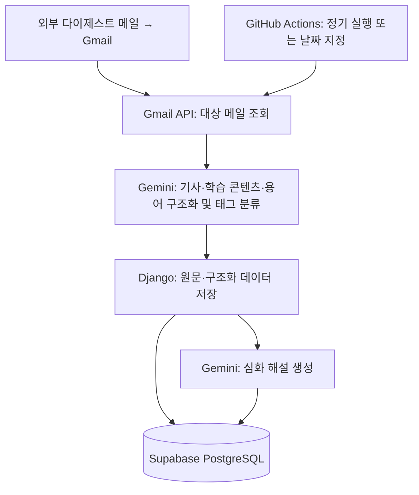
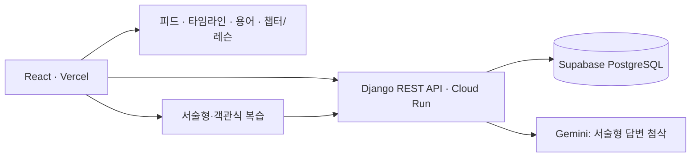

# SSD Digest App

**매일 도착하는 SSD·자동차 SW 뉴스를 개념 학습과 복습으로 연결하는 개인 학습 앱.**

SSD/NAND 컨트롤러 펌웨어 및 자동차 SW 취업 준비를 위한 개인 학습 인프라.
메일을 읽고, 용어를 찾아보고, 내용을 따로 정리하는 반복 작업을 줄여
개념 이해와 반복 학습에 시간을 쓰는 것이 목표.

[전체 파이프라인](#전체-파이프라인) · [주요 기능](#주요-기능) · [로컬 실행](#로컬-실행) · [운영 문서](docs/operations.md)

## 학습 흐름

매일의 기사와 기초 개념을 같은 태그로 연결해, 새로운 소식을 기존 학습 맥락에서 이해하도록 구성.

1. **매일의 기사 읽기**: 오늘 피드에서 기사 요약과 인사이트 확인.
2. **기초 개념 학습**: 용어 사전과 챕터 레슨에서 모르는 개념 확인.
3. **실제 사례 연결**: 챕터의 관련 기사·용어를 통해 개념의 활용 사례 탐색.
4. **이해도 확인과 복습**: 서술형·객관식 문제 풀이 후 일정 간격으로 반복 학습.

## 전체 파이프라인

### 콘텐츠 수집과 저장

- **입력 데이터**: 외부에서 발송되어 Gmail에 도착한 「SSD/자동차 SW 펌웨어 데일리 브리핑」 메일.
- **프로젝트 범위**: 메일 수집 → 구조화·저장 → 학습 화면 제공.
- **외부 처리 범위**: 뉴스 검색과 원본 메일 작성·발송.



- **저장 순서**: 파싱 결과 검증 → DB 저장 → 심화 해설 생성.
- **해설 생성 실패 시**: 저장된 다이제스트 유지, 앱에서 해설 생성 재시도 가능.
- **중복 처리**: 이미 저장된 날짜는 기본적으로 건너뛰기.

### 웹에서 학습과 복습



일별 콘텐츠와 미리 작성한 커리큘럼을 태그로 연결.
레슨은 시드 데이터로 관리하고, 복습 결과에 따라 다음 복습 간격 조정.

## 주요 기능

| 기능 | 할 수 있는 일 |
|---|---|
| 오늘 피드 | 최신 기사·학습 콘텐츠를 읽고 카테고리와 태그로 탐색 |
| 타임라인 | 날짜별 다이제스트를 다시 확인 |
| 챕터·레슨 | 선행 개념 순서에 따라 학습하고 관련 기사·용어 확인 |
| 용어 사전 | 누적 용어와 개념 콘텐츠를 검색하고 카테고리별로 탐색 |
| 복습 | 서술형 답변의 AI 첨삭 또는 객관식 문제로 복습 |
| 스트릭 | 연속 복습일수 확인 |
| 회원가입·로그인 | 아이디·비밀번호로 가입 후 바로 로그인, 계정별 복습·질문·인사이트 관리 |
| 계정 삭제 | 상단 아이디 → 계정 관리에서 현재 비밀번호 확인 후 회원 탈퇴. 개인 기록 삭제, 공용 콘텐츠 유지 |

커리큘럼은 SSD 트랙(NAND → 호스트 인터페이스 → FTL → 컨트롤러 → 신뢰성 → 차세대)과
자동차 트랙(차량 전자 구조 → 차량 통신 → AUTOSAR & SDV → 기능안전·보안 → ADAS/응용 SW)으로 구성.

## 주요 설계 결정

- **LLM 기반 구조화**: 가변적인 메일 형식에 대응하기 위해 기사·학습 콘텐츠·용어를 LLM으로 추출하고 원문 보관.
  파싱 구현 위치: `fetcher/gemini_parser.py`.
- **태그 기반 학습 연결**: 기사와 용어를 주제로 묶고, 학습 순서가 있는 태그를 챕터로 확장해 뉴스와 커리큘럼 연결.
- **사전 작성 레슨**: 검토한 콘텐츠를 시드로 관리하고, Markdown과 인라인 SVG로 설명과 도식 제공.
- **PC와 독립적인 수집**: GitHub Actions에서 정기 수집 실행. API는 Cloud Run, 프론트엔드는 Vercel에서 제공.

모델 구조와 콘텐츠 작성 규칙: [커리큘럼 문서](docs/curriculum.md).

## 기술 스택

| 영역 | 사용 기술 |
|---|---|
| 프론트엔드 | React, Vite, React Router, CSS, marked |
| 백엔드·인증 | Django, Django REST Framework, TokenAuthentication |
| 데이터베이스 | Supabase PostgreSQL, 로컬 SQLite 지원 |
| 메일·AI | Gmail API(OAuth 2.0), Gemini API |
| 수집 자동화 | GitHub Actions |
| 배포 | Vercel, Google Cloud Run, Artifact Registry, Cloud Build |

패키지 버전: [requirements.txt](requirements.txt), [frontend/package.json](frontend/package.json).
백엔드 배포: `master` push → 연결된 Cloud Build 트리거 실행 →
`cloudbuild.yaml`에 정의된 빌드 → 이미지 업로드 → Cloud Run 배포.

## 로컬 실행

실행 환경: Actions와 동일한 **Python 3.12**, 프론트엔드용 Node.js 및 npm.

### 1. 환경 설정

프로젝트 루트에 `.env` 생성. 아래는 로컬 SQLite 사용 예시.

```dotenv
DJANGO_SECRET_KEY=local-development-key
DJANGO_DEBUG=True
DJANGO_ALLOWED_HOSTS=localhost,127.0.0.1,testserver
DATABASE_URL=sqlite:///db.sqlite3
GEMINI_API_KEY=your-gemini-api-key
```

- **DB 설정**: `DATABASE_URL` 생략 시 SQLite 사용. Supabase 주소 설정 시 로컬 명령도 해당 DB에 반영되므로 개발용 DB와 서비스 DB 구분 필요.
- **Gmail 인증**: 데스크톱 앱 OAuth 클라이언트 JSON을 `fetcher/credentials.json`에 저장.
  최초 수집 시 브라우저 인증 후 `fetcher/token.json` 자동 생성.

### 2. 백엔드 실행

가상환경 생성·활성화 후 프로젝트 루트에서 실행.

```bash
pip install -r requirements.txt
python manage.py migrate
python manage.py seed_tags
python manage.py seed_lessons
python manage.py seed_lesson_pages
python manage.py createsuperuser
python manage.py runserver
```

앱 로그인 화면의 **회원가입**으로 일반 계정 생성 가능. `createsuperuser`는 관리자 계정 생성용.
메일 수집은 별도로 `python manage.py fetch_digest` 실행.

### 3. 프론트엔드 실행

별도 터미널에서 실행.

```bash
cd frontend
npm install
npm run dev
```

- **기본 API 주소**: `http://127.0.0.1:8000/api`.
- **다른 백엔드 연결**: `frontend/.env`에 `VITE_API_BASE` 설정.

## 자동화와 누락 날짜 복구

- **정기 실행**: [수집 워크플로](.github/workflows/fetch_digest.yml)에서 KST 05:00~06:45 사이 15분 간격 실행.
- **기본 수집 대상**: 최근 메일 중 최신 다이제스트.
- **일시적 오류 대응**: Gemini의 500·502·503·504 응답에 대해 클라이언트에서 20초 간격 재시도.

**누락 날짜 복구는 날짜를 직접 지정하는 방식.** 과거 누락분의 일괄 자동 복구는 미지원.

1. **수동 실행 열기**: 날짜 지정 기능이 반영된 브랜치에서 GitHub **Actions → Fetch Daily Digest → Run workflow** 선택.
2. **대상 날짜 입력**: `date`에 `2026-10-13`처럼 메일 제목의 날짜 입력 후 실행.
3. **복구 결과 확인**: 실행 로그와 앱 타임라인 확인. 다른 날짜는 각각 별도 실행.

`date`를 비우면 최신 메일 수집. 아래 명령으로 로컬 실행도 가능.

```bash
python manage.py fetch_digest                     # 최신 메일 수집
python manage.py fetch_digest --date 2026-10-13   # 특정 날짜 복구
python manage.py fetch_digest --dry-run           # DB 저장 없이 파싱 결과 확인
python manage.py fetch_digest --force             # 선택된 날짜의 기존 콘텐츠 교체
```

- **중복 저장 방지**: 이미 저장된 날짜는 기본적으로 건너뛰며, 누락 날짜 복구에는 `--force` 불필요.
- **미리보기 범위**: `--dry-run`은 DB 저장만 생략하며 Gmail 및 Gemini API 호출 포함.

Actions 실행에 필요한 GitHub Secrets. 로컬 인증 파일과 별도 관리.

| Secret | 용도 |
|---|---|
| `GMAIL_CREDENTIALS_JSON` | Gmail OAuth 클라이언트 JSON |
| `GMAIL_TOKEN_JSON` | Gmail 접근 토큰 및 갱신 정보 |
| `GEMINI_API_KEY` | 구조화·해설 생성 API 인증 |
| `DATABASE_URL` | 저장 대상 DB 연결 |
| `DJANGO_SECRET_KEY` | Django 실행 설정 |

배포 절차와 기존 장애 대응 기록: [운영 문서](docs/operations.md).

## 코드 둘러보기

```text
ssd_studyapp/
├── config/                  # Django 설정·URL
├── digest/                  # 데이터 모델·REST API·관리 명령
│   └── management/commands/ # 수집 및 커리큘럼 시드
├── fetcher/                 # Gmail 수집·Gemini 파싱·원문 순서 처리
├── frontend/src/            # React 화면·컴포넌트·API 클라이언트
├── .github/workflows/       # 수집 자동화
├── cloudbuild.yaml          # 백엔드 빌드·배포
└── docs/                    # 운영·커리큘럼 상세 문서
```

## 앞으로 할 것

- [ ] PWA 오프라인 지원
- [ ] 질문·인사이트 전체 모아보기 화면
- [ ] 용어 숙련도 통계·대시보드
- [ ] 콘텐츠가 쌓인 자동차 트랙 일반 태그를 챕터로 확장
- [ ] 챕터·레슨 완료 체크 및 학습 진행률
